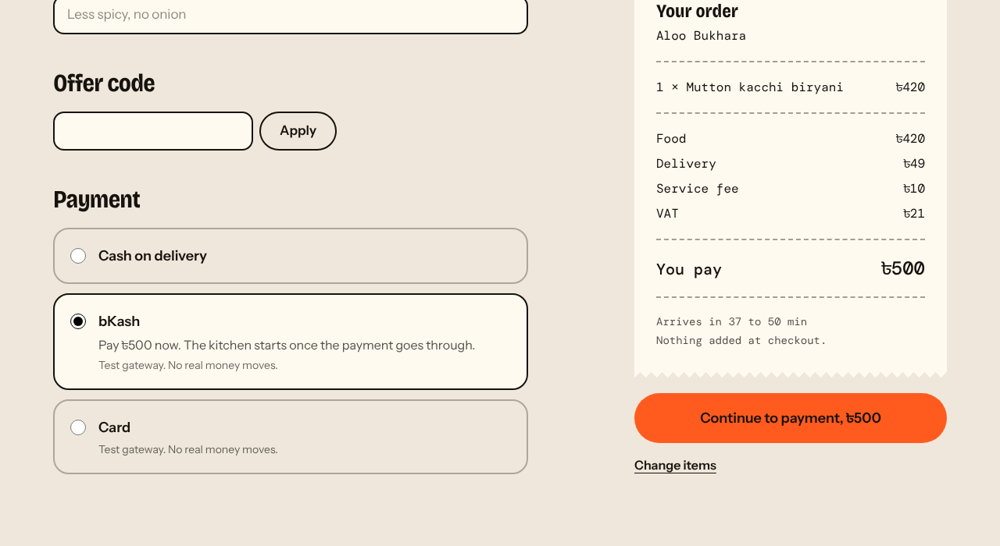
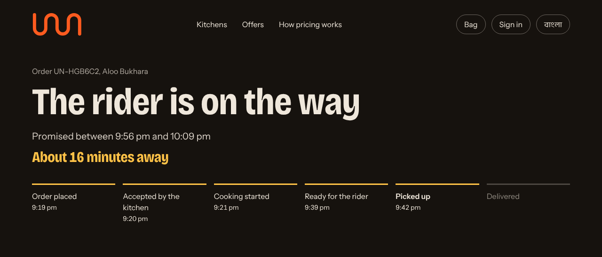
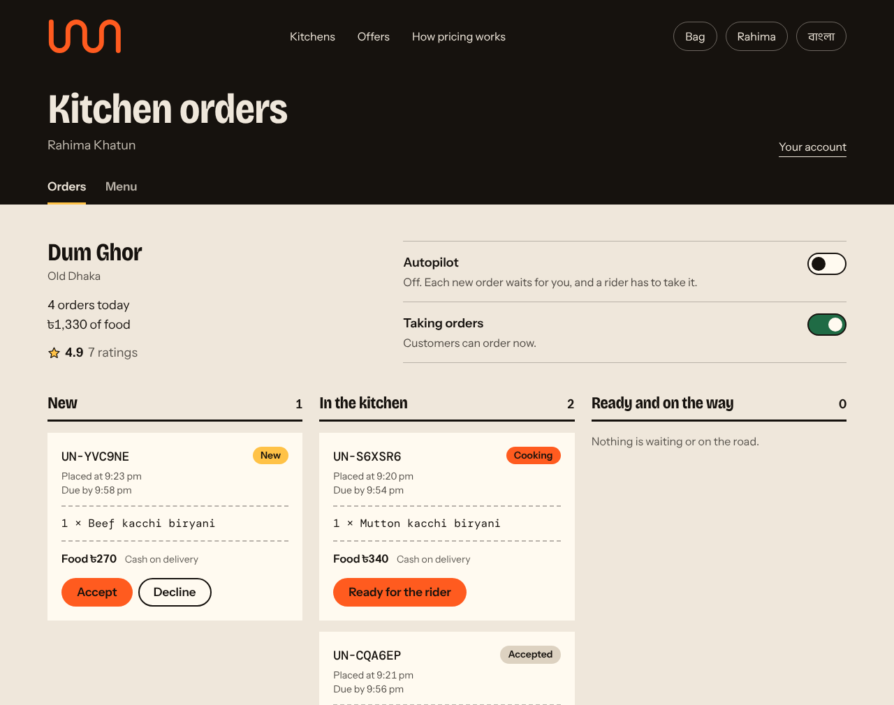
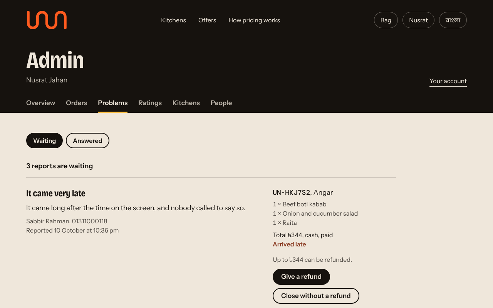
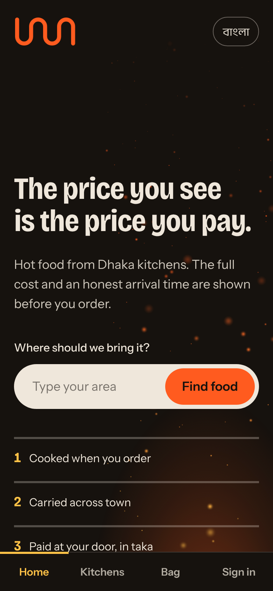
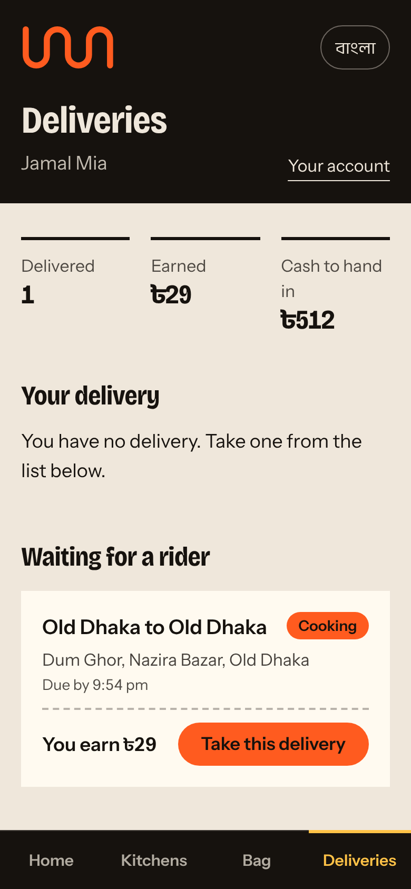
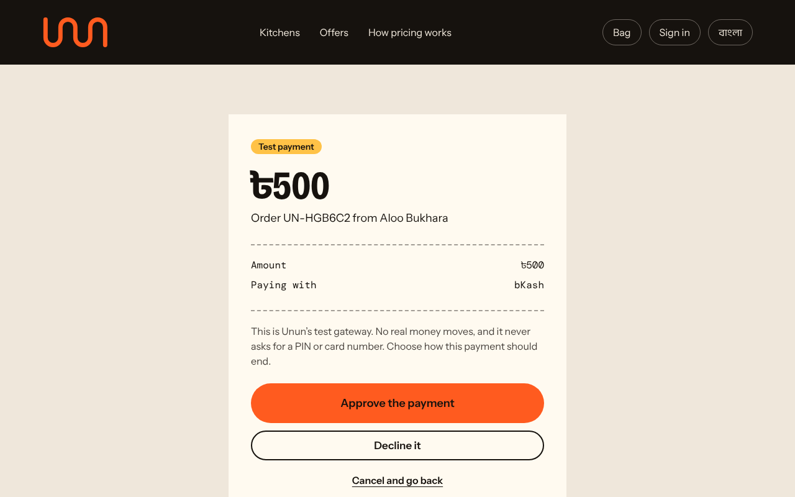

# Unun

[](https://github.com/SifatSwapnil2022/Unun/actions/workflows/ci.yml)

Unun (উনুন, the clay stove) is a food delivery platform for Dhaka. Its promise is simple:
the price you see is the price you pay, and the arrival time shown is the one you get.

A customer can find a kitchen, order, pay, follow the rider on a map, rate the food and
report a problem. A restaurant owner, a rider and an admin each have their own
workspace. The site is in English and Bangla, and installs on a phone like an app.

**Live demo: [unun-dhaka.netlify.app](https://unun-dhaka.netlify.app)**. The sign-in page
has one-click demo accounts for every role.

This is a portfolio project by [Md Sifatullah Sheikh](https://github.com/SifatSwapnil2022).
The 69 kitchens are invented; the areas, streets, dishes and price levels are real Dhaka.
No real food is delivered and no real money moves.

<p>
  
  
</p>
<p>
  
  
</p>
<p>
  
  
  
</p>

Kitchen and dish photographs load from Unsplash while the site runs, so the screens
that carry them are not pictured here.

## What is inside

| Part            | Built with                                    | Does                                                   |
| --------------- | --------------------------------------------- | ------------------------------------------------------ |
| `apps/web`      | Next.js 16, React 19, Tailwind CSS 4, Leaflet | The site: customers and the three workspaces           |
| `apps/api`      | Hono, Drizzle ORM, PostgreSQL, Zod            | Prices every order, checks every role, takes payments  |
| `packages/core` | TypeScript                                    | The rules the site and the API share                   |
| `services/ml`   | Python, FastAPI, scikit-learn                 | Arrival-time model, spelling-proof search, suggestions |
| `e2e`           | Playwright                                    | Browser tests of whole journeys                        |

464 automated tests: 366 in TypeScript, 91 in Python and 7 in a real browser.
Seventeen short decision records in [`docs/adr`](docs/adr) say why things are the way
they are.

## Quick start

Requires Node.js 22 or newer.

```bash
git clone https://github.com/SifatSwapnil2022/Unun.git
cd Unun
npx pnpm@10 install
npx pnpm@10 dev
```

Open http://localhost:3000. Nothing else needs installing: the database runs inside
Node and fills itself with demo data. The sign-in page lists six demo accounts, one
click each, for a customer, two restaurant owners, two riders and an admin.

The Python part is optional and needs Python 3.11 or newer. Run
`npx pnpm@10 ml:setup` once, and `dev` starts it too. [Run it](#run-it) has the details.

## Status

| Step | Scope                                                                   | State |
| ---- | ----------------------------------------------------------------------- | ----- |
| 1    | Repository, brand system, home page in English and Bangla               | Done  |
| 2    | API, database, 69 kitchens, search, menus, bag, checkout, order page    | Done  |
| 3    | Sign-in and accounts; restaurant owner, rider and admin workspaces      | Done  |
| 4    | bKash and card payment through a test gateway, live map tracking        | Done  |
| 5    | Ratings from delivered orders, problem reports and refunds, allergens   | Done  |
| 6    | Arrival-time model, search that survives spelling, suggestions (Python) | Done  |

It also installs on a phone's home screen and opens like an app. What is not done is
listed under [Known limits](#known-limits).

## What you can do today

There are four kinds of account. Everyone can order food; a role adds a workspace.

**A customer** can complete a purchase from start to finish:

1. Type an area on the home page.
2. Browse the kitchens that deliver there. Search by kitchen or dish in English, in
   Bangla, or in Bangla written with English letters; "kachi biriani" finds kacchi
   biryani. Filter by cuisine and sort by closest match, arrival time, fee, on-time
   record or rating.
3. Open a kitchen and read the menu. Every dish says what it contains, and dishes with
   milk, nuts or eight other things can be left out. Fill a bag: it shows the full
   price (food, delivery, service fee, VAT) from the first item, and suggests what goes
   with it.
4. Check out with cash on delivery, bKash or card, with or without signing in. An offer
   code can be applied. bKash and card go through a test gateway, where a payment is
   approved or declined by pressing a button and no money moves.
5. Follow the order from the kitchen to the door on a map, and see whether it arrived
   inside the window that was promised.
6. Rate the kitchen once the food has arrived. If something was wrong, report it, and
   see the answer and any refund on the same page.

Signed in, a customer also has an account page with their past orders and saved
addresses, checkout fills in their details, and the home page picks kitchens for them
from what they have ordered before.

**A restaurant owner** has an order board for their kitchen (`/en/partner`): accept or
decline a new order, start cooking, mark it ready. They can pause the kitchen, take a
dish off the menu, change its price and correct what it contains, and they see their
ratings.

**A rider** has a delivery screen (`/en/rider`): take an order that is being cooked,
pick it up when it is ready, deliver it, and collect the cash or nothing if it was paid
online. Their phone shares its position while they carry an order, which is what moves
the pin on the customer's map. It shows what they have delivered and earned today.

**An admin** (`/en/admin`) sees the day's and the week's figures, every order (and can
cancel one, with a reason, which refunds it if it was paid), every problem report (and
answers it, with or without a refund), every rating (and can hide one), every kitchen
and every person.

### On a phone

On a narrow screen the site has a tab bar at the bottom, dialogs rise from the bottom
edge, and pages keep clear of the notch and the home indicator. From the browser's
menu, "Add to Home Screen" (iPhone) or "Install app" (Android) puts Unun on the home
screen with its own icon; it then opens full screen, without the browser's bars. With
no connection it shows a page that says so instead of the browser's error.

This is the web app, installed. There is no separate app in the App Store or on Google
Play.

### Signing in, and the demo accounts

Sign-in is by mobile number and a six-digit one-time code. No SMS gateway is connected,
so in demo mode the code is shown on the page. The sign-in page lists six seeded
accounts that sign in with one click:

| Role             | Name          | Number        | Notes             |
| ---------------- | ------------- | ------------- | ----------------- |
| Customer         | Rahim Uddin   | `01700000006` | Has a saved home  |
| Restaurant owner | Rahima Khatun | `01700000002` | Runs Dum Ghor     |
| Restaurant owner | Kamal Hossain | `01700000003` | Runs Koylar Aanch |
| Rider            | Jamal Mia     | `01700000004` |                   |
| Rider            | Sumon Ali     | `01700000005` |                   |
| Admin            | Nusrat Jahan  | `01700000001` |                   |

Any other mobile number creates a new customer account. Demo mode also seeds four weeks
of finished orders, with the ratings and a handful of problem reports that came out of
them, so every screen has something to show.

### Autopilot, and following one order by hand

Most of the 69 kitchens have nobody at their screen, so each kitchen has an **autopilot**
switch. With it on (the default), a simulator accepts, cooks and delivers every order,
30 times faster than real time, so an order finishes in a minute or two. With it off,
each new order waits for the owner, and a rider has to take it.

To follow one order through every pair of hands, use three browser windows (or one
normal, one private, and a second browser), because each holds one sign-in:

1. Sign in as Rahima and switch autopilot off on her order board.
2. In another window, sign in as Rahim and order from Dum Ghor.
3. As Rahima, accept the order and start cooking.
4. In a third window, sign in as Jamal and take the delivery.
5. As Rahima, mark the order ready. As Jamal, pick it up, then deliver it.

The customer's tracking page follows along at every step.

### The learning service

Three things are worked out by a small Python service in [`services/ml`](services/ml):

- **Arrival time.** A model predicts a window for each order from the kitchen's cooking
  time, the distance, the hour, the day, how busy the kitchen is and how big the order
  is. It is trained on invented deliveries, because the demo has no real ones.
- **Search.** Spellings of one word are folded together, so English, Bangla and the
  mix of the two that people type all find the same dish.
- **Suggestions.** "Goes well with it" in the bag, and "Because you ordered" on the
  home page, are found in past orders.

The service is an extra. Without it the site still works: arrival times come from a
plain rule, search matches the letters as typed, and the bag suggests best sellers.
What each of the three does, how it was measured and what it gets wrong is in
[`services/ml/README.md`](services/ml/README.md) and the reports beside it.

## Run it

Requires Node.js 22 or newer and pnpm 10. The commands below are written as `pnpm`;
without pnpm installed, put `npx pnpm@10` in its place.

```bash
pnpm install
pnpm dev
```

Then open http://localhost:3000. The API runs on http://localhost:4000.

To add the learning service, which needs Python 3.11 or newer, run this once:

```bash
pnpm ml:setup
```

It makes a Python environment in `services/ml/.venv`, installs the packages and trains
the arrival-time model. After that, `pnpm dev` starts the service too, on
http://127.0.0.1:8000.

Nothing else needs installing. Without a `DATABASE_URL` the API uses PGlite, a build of
PostgreSQL that runs inside Node, and stores its files in `apps/api/.data`. On first
start it creates the tables and fills them with the demo data. When the demo data in the
code changes, the embedded database is rebuilt on the next start, so orders placed in it
before that are gone.

### Photographs and the hero film

Every kitchen has a cover photograph and a round profile picture, every dish on every
menu has a photograph, and the home page plays a three-scene film: a cook at the grill,
a rider crossing town, a handover at the door. All of it appears on the first
`pnpm dev`, with no extra step.

The pictures are free stock, listed in [`media/manifest.json`](media/manifest.json)
with their photographers. By default the browser loads each one from its source
(Unsplash for photographs, Mixkit and Pexels for the clips), so the site needs an
internet connection to show them. If a picture cannot be loaded, its place is taken by
a flat colour block with the kitchen's name, or by the ember scene for the film; nothing
on the page breaks.

| Command              | What it does                                                          |
| -------------------- | --------------------------------------------------------------------- |
| `pnpm media:check`   | Requests every address and lists the ones that no longer answer       |
| `pnpm media:fetch`   | Downloads everything into `apps/web/public/media` and uses the copies |
| `pnpm media:library` | Rebuilds the list the site reads, after you add or remove a file      |

A copy on disk always wins over the remote address. To replace a photograph, change its
`image` and `page` in the manifest and run `pnpm media:library`. To use your own film,
see [`apps/web/public/media/README.md`](apps/web/public/media/README.md). Restart
`pnpm dev` after any of these.

The kitchens are invented, so the photographs are stand-ins chosen to look like each
dish. The `/credits` page shows every photograph beside what it stands for, which is
the quick way to find one that does not fit.

### Commands

| Command             | What it does                                                    |
| ------------------- | --------------------------------------------------------------- |
| `pnpm dev`          | Starts the API and the site, and the learning service if set up |
| `pnpm build`        | Builds the API and the site for production                      |
| `pnpm test`         | Runs every unit test (the API tests start their own database)   |
| `pnpm e2e`          | Runs the browser tests. `pnpm e2e:install` first, once          |
| `pnpm lint`         | Lints every package                                             |
| `pnpm typecheck`    | Type-checks every package                                       |
| `pnpm format:check` | Checks formatting without changing files                        |
| `pnpm db:reset`     | Deletes the embedded database so it is seeded again             |
| `pnpm ml:setup`     | Once: makes the Python environment and trains the model         |
| `pnpm ml:test`      | Runs the Python tests                                           |
| `pnpm ml:evaluate`  | Measures the three models and rewrites `services/ml/reports`    |
| `pnpm ml:train`     | Trains the arrival-time model again                             |
| `pnpm ml:export`    | Rewrites the demo data the Python service ships with            |

The three `media:` commands are described above.

### Settings

Copy `apps/api/.env.example` to `apps/api/.env` to change them.

| Setting            | Default                 | Meaning                                            |
| ------------------ | ----------------------- | -------------------------------------------------- |
| `PORT`             | `4000`                  | Port of the API                                    |
| `DATABASE_URL`     | empty                   | A PostgreSQL server. Empty uses the embedded one   |
| `WEB_ORIGIN`       | `http://localhost:3000` | The origin allowed to call the API from a browser  |
| `DEMO_SPEED`       | `30`                    | How much faster than real time orders move         |
| `DEMO_ALWAYS_OPEN` | `1`                     | `0` enforces each kitchen's opening hours          |
| `DEMO_LOGIN`       | `1`                     | `0` hides sign-in codes and seeds no demo accounts |
| `ADMIN_PHONE`      | empty                   | A number made an admin each time the API starts    |
| `PAYMENT_SANDBOX`  | `1`                     | `0` turns the test gateway off                     |
| `BKASH_USERNAME`…  | empty                   | Four bKash merchant settings. See below            |
| `API_PUBLIC_URL`   | `http://localhost:4000` | Where a payment gateway sends the customer back    |
| `ML_URL`           | `http://127.0.0.1:8000` | The learning service. `off` runs without it        |
| `INTERNAL_KEY`     | a fixed key, in dev     | What the learning service sends to read its data   |

The web app reads `API_URL` (default `http://localhost:4000`) from `apps/web/.env`.

With `BKASH_USERNAME`, `BKASH_PASSWORD`, `BKASH_APP_KEY` and `BKASH_APP_SECRET` set,
bKash payments go to bKash's tokenized checkout instead of the test gateway. That code
follows bKash's published API and is tested against a stand-in for their servers. It
has not been run against bKash itself, which needs a merchant account.

`DEMO_LOGIN=1` is for showing the project. The demo accounts are open to anyone and
the code is handed to the page, so set it to `0` wherever real people sign in. Codes
are then printed where the API runs until an SMS gateway is connected, and
`ADMIN_PHONE` creates the first admin.

## Deploy to Netlify

The whole project runs as one Netlify site: the web app, the API as a Netlify function,
and a PostgreSQL database. The settings live in [`apps/web/netlify.toml`](apps/web/netlify.toml),
and [decision 17](docs/adr/0017-one-netlify-site-with-the-api-as-a-function.md) explains
the shape.

1. In Netlify, choose **Add new project**, then **Import an existing project**, and pick
   this repository on GitHub.
2. Netlify finds several apps in it. Choose **apps/web**. That sets the package directory
   to `apps/web` and leaves the base directory empty, which is what the build expects.
   Leave the build command and publish directory as they are; `netlify.toml` sets them.
3. Deploy.

Netlify provisions a PostgreSQL database for the site as part of that deploy, because
`apps/web` depends on `@netlify/database`. The API reads it as `NETLIFY_DB_URL`. On its
first request the API creates the tables and loads the 69 kitchens and four weeks of
demo orders, so the very first visit takes a few seconds longer.

Netlify Database needs one of Netlify's credit-based plans, which new accounts have. On
an older plan, or to use another server, create a PostgreSQL database with a provider
such as [Neon](https://neon.tech) and add its connection string to the site as the
environment variable `DATABASE_URL`. It takes precedence over `NETLIFY_DB_URL`.

Every setting in [Settings](#settings) can be added as an environment variable. On
Netlify, `WEB_ORIGIN` and `API_PUBLIC_URL` follow the site's address, and the Python
service is off unless `ML_URL` points at a copy hosted somewhere that runs Python.

## How it is built

```
Browser
  │  pages, rendered on the server      /api/*, forwarded to the API
  ▼                                        │
apps/web   Next.js 16, React 19  ──────────┤
  │  uses                                  ▼
packages/core  ◄──── uses ────  apps/api   Hono, Drizzle ORM ──── asks ───►  services/ml
  money, pricing, delivery,                │        ▲                       FastAPI, scikit-learn
  promotions, order states,                ▼        └── menus and orders ── arrival time, search,
  payments, feedback            PostgreSQL (PGlite in development)          suggestions
```

- **`packages/core`** holds the rules both sides must agree on: money in whole paisa,
  the one function that prices an order, delivery fee and arrival window, promotion
  rules, order states, and the API contract. The bag in the browser and the API price
  an order with the same function.
- **`apps/api`** is one service split into modules (`catalogue`, `orders`, `payments`,
  `feedback`, `auth`, `account`, `partner`, `rider`, `admin`, `ml`). Requests are
  validated with the schemas in `packages/core`. The server prices every order itself;
  the client sends the total it showed, and the order is refused if the two differ.
- **`services/ml`** is called only by the API, with a short time limit. Any failure
  there comes back to the API as "no answer", and the API uses its own plain rule.
- **`apps/web`** renders pages on the server and keeps the bag in the browser. The
  browser only talks to the web app's own origin: `/api/*` is forwarded to the API, so
  the session cookie stays first-party.

A session is a random token in an `HttpOnly`, `SameSite=Lax` cookie; the database
keeps only its hash. Every route that changes something needs the right role, checks
that the kitchen or delivery belongs to the person asking, and only accepts JSON, which
a form on another site cannot send. An order's state is never a column that can be set:
it is the latest stored event, and each event is checked against the rules in
`packages/core` (one step at a time, kitchen steps by the kitchen, rider steps by the
rider who took the order).

An order paid online is stored but not started: the kitchen hears of it when the
payment goes through, and an unpaid order lapses after fifteen minutes. A refund is
written down before it is sent, so money never goes back without a record. A rating or
a problem report cannot exist without a delivered order.

### API

| Method | Path                 | Purpose                                                |
| ------ | -------------------- | ------------------------------------------------------ |
| GET    | `/v1/areas`          | Delivery areas                                         |
| GET    | `/v1/cuisines`       | Cuisines with kitchen counts                           |
| GET    | `/v1/offers`         | Advertised offer codes                                 |
| GET    | `/v1/kitchens`       | Kitchens. Query: `area`, `cuisine`, `q`, `tag`, `sort` |
| GET    | `/v1/kitchens/:slug` | One kitchen with its menu. Query: `area`               |
| POST   | `/v1/quotes`         | Prices a bag and checks an offer code                  |
| POST   | `/v1/orders`         | Places an order. Accepts an `Idempotency-Key` header   |
| GET    | `/v1/orders/:token`  | An order and how far it has got                        |

Paying, and what happens after the food arrives. Whoever holds an order's link may use
the last three:

| Method | Path                          | Purpose                                         |
| ------ | ----------------------------- | ----------------------------------------------- |
| GET    | `/v1/payment-options`         | The ways to pay that are on offer               |
| GET    | `/v1/payments/:token`         | One attempt to pay                              |
| POST   | `/v1/payments/:token/sandbox` | Approve, decline or cancel, at the test gateway |
| GET    | `/v1/payments/bkash/callback` | Where bKash sends the customer back             |
| POST   | `/v1/orders/:token/pay`       | A new attempt after a failed one                |
| POST   | `/v1/orders/:token/rating`    | Rates a delivered order, once                   |
| POST   | `/v1/orders/:token/issues`    | Reports a problem with a delivered order        |
| GET    | `/v1/kitchens/:slug/pairings` | Dishes that go with the bag. Query: `items`     |

Signing in and the account (the last five need a session):

| Method | Path                     | Purpose                                  |
| ------ | ------------------------ | ---------------------------------------- |
| POST   | `/v1/auth/code`          | Sends a one-time code to a mobile number |
| POST   | `/v1/auth/verify`        | Checks the code and starts a session     |
| POST   | `/v1/auth/signout`       | Ends the session                         |
| GET    | `/v1/auth/demo-accounts` | The seeded accounts, in demo mode        |
| GET    | `/v1/me`                 | The signed-in person, or `null`          |
| PATCH  | `/v1/me`                 | Changes their name                       |
| GET    | `/v1/me/orders`          | Their orders, newest first               |
| GET    | `/v1/me/recommendations` | Kitchens picked from their past orders   |
| GET    | `/v1/me/addresses`       | Their saved addresses                    |
| POST   | `/v1/me/addresses`       | Saves an address (up to six)             |
| DELETE | `/v1/me/addresses/:id`   | Removes one                              |

The workspaces. Each group needs its role:

| Method | Path                             | Role  | Purpose                                            |
| ------ | -------------------------------- | ----- | -------------------------------------------------- |
| GET    | `/v1/partner/kitchens`           | owner | The kitchens the owner runs                        |
| GET    | `/v1/partner/board`              | owner | A kitchen's open and finished orders               |
| PATCH  | `/v1/partner/kitchens/:slug`     | owner | Autopilot on or off, pause or resume               |
| GET    | `/v1/partner/menu`               | owner | The kitchen's menu                                 |
| PATCH  | `/v1/partner/items/:id`          | owner | A dish's price, allergens, or whether it is served |
| POST   | `/v1/partner/orders/:id/advance` | owner | Accept, start cooking, mark ready                  |
| POST   | `/v1/partner/orders/:id/decline` | owner | Decline a new order, with a reason                 |
| GET    | `/v1/rider/board`                | rider | Their delivery, waiting orders, today              |
| POST   | `/v1/rider/orders/:id/claim`     | rider | Take a waiting delivery                            |
| POST   | `/v1/rider/orders/:id/advance`   | rider | Picked up, delivered                               |
| POST   | `/v1/rider/location`             | rider | Where their phone is, while carrying an order      |
| GET    | `/v1/admin/overview`             | admin | Today's and the week's figures                     |
| GET    | `/v1/admin/orders`               | admin | Orders. Query: `scope`, `q`                        |
| POST   | `/v1/admin/orders/:id/cancel`    | admin | Cancel an order, with a reason                     |
| GET    | `/v1/admin/issues`               | admin | Problem reports. Query: `scope`                    |
| POST   | `/v1/admin/issues/:id/resolve`   | admin | Answer one, with or without a refund               |
| GET    | `/v1/admin/reviews`              | admin | Ratings. Query: `scope`                            |
| PATCH  | `/v1/admin/reviews/:id`          | admin | Hide a rating, or show it again                    |
| GET    | `/v1/admin/system`               | admin | Whether the learning service is running            |
| GET    | `/v1/admin/kitchens`             | admin | Every kitchen                                      |
| PATCH  | `/v1/admin/kitchens/:slug`       | admin | Hide or show it, change its owner                  |
| GET    | `/v1/admin/users`                | admin | People. Query: `role`, `q`                         |
| PATCH  | `/v1/admin/users/:id`            | admin | Change a person's role                             |

Errors have one shape: `{ "error": { "code", "message", "details" } }`.

Two more addresses, `/internal/ml/catalogue` and `/internal/ml/orders`, give the
learning service the menus and the finished orders. They take `INTERNAL_KEY` in a
header instead of a session, and the orders they give have no names, numbers or
addresses in them.

### Tests

| Where           | What is covered                                                                                                                                                                                                                                                                                                                 |
| --------------- | ------------------------------------------------------------------------------------------------------------------------------------------------------------------------------------------------------------------------------------------------------------------------------------------------------------------------------- |
| `packages/core` | Pricing, delivery fee and window, promotions, order states and who may move them, how an order's money stands, when it can be rated or reported, allergens, sign-in codes, phone numbers, opening hours                                                                                                                         |
| `apps/api`      | Every endpoint against an in-memory PostgreSQL: sign-in and its limits, who may do what in each workspace, an order moved by hand from placed to delivered, paying and refunding (bKash against a stand-in for its servers), ratings and reports, the learning service answering, failing and answering nonsense, the seed data |
| `apps/web`      | The bag, the list of things a customer avoids, formatting of numbers, money, clock times and dates in both languages, the media library, and the rule for where sign-in may send someone                                                                                                                                        |
| `services/ml`   | Transliteration and spelling keys, search on right and wrong spellings and on food nobody sells, suggestions, the arrival-time model against the plain rule, and every address of the service                                                                                                                                   |
| `e2e`           | In a real browser: a cash order followed to delivery and rated, an online payment declined then approved, dishes hidden by allergen, the Bangla pages, the phone layout, and one order passed from kitchen to rider to customer and refunded                                                                                    |

The browser tests start their own API and site on other ports with an empty database,
and replace photographs and map tiles with stand-ins, so they need no network.

## Layout

```
unun/
├── apps/
│   ├── api/                    The backend
│   │   ├── drizzle/            SQL migrations
│   │   └── src/
│   │       ├── db/             Schema and connection
│   │       ├── http/           Errors, sessions, request parsing, rate limiting
│   │       ├── modules/        catalogue/, orders/, payments/, feedback/, auth/, account/,
│   │       │                   partner/, rider/, admin/, ml/
│   │       ├── routes/         The HTTP routes of each module
│   │       └── seed/           Areas, dishes, allergens, kitchens, menus, offers, demo
│   │                           accounts, past orders, ratings
│   └── web/                    The site: customers and the three workspaces
│       ├── public/             App icons, the offline page and its service worker, and
│       │                       local copies of photographs and clips, if fetched
│       └── src/
│           ├── app/[locale]/   Home, kitchens, kitchen, checkout, pay, order, credits,
│           │                   sign-in, account, partner, rider, admin
│           ├── components/     brand/, home/, kitchen/, bag/, checkout/, pay/, order/,
│           │                   map/, ui/, layout/, auth/, account/, work/, partner/,
│           │                   rider/, admin/
│           ├── i18n/           The English and Bangla dictionaries
│           └── lib/            API client, session, bag, formatting
├── packages/core/              Rules shared by the API and the site
├── services/ml/                The learning service, in Python
│   ├── unun_ml/                text, search, pairings, delivery, the HTTP app
│   ├── data/                   Demo menus, orders and the labelled search queries
│   ├── reports/                What each model scored, written by the evaluation
│   └── tests/
├── e2e/                        Browser tests
├── media/manifest.json         Where each photograph and clip comes from
├── scripts/                    dev.mjs, media.mjs, ml.mjs
├── docs/adr/                   Decision records
└── .github/workflows/ci.yml    Format, lint, type check, test, build, Python tests
```

## Design

| Token    | Value     | Used for                            |
| -------- | --------- | ----------------------------------- |
| Soot     | `#16120e` | Text, the header and footer ground  |
| Ember    | `#ff5b1f` | The logo, primary actions           |
| Ash      | `#efe7db` | Page ground                         |
| Turmeric | `#ffc247` | Progress, labels, the pricing block |
| Leaf     | `#1f6b45` | On-time records                     |
| Clay     | `#8a3b22` | Errors and a cuisine block          |
| Paper    | `#fffaf0` | The receipt and form fields         |

Typefaces: Bricolage Grotesque for headlines, Instrument Sans for text, Anek Bangla for
Bangla, DM Mono on paper only: the receipt and the kitchen's order tickets. The logo is
one unbroken stroke (`apps/web/src/components/brand/Logo.tsx`), and the app icons are
drawn from the same path. There is no icon set: the interface uses words, numbers and
flat colour. The one drawn shape is the rating star.

## Known limits

What is real and what is not:

- **No real money moves.** bKash and card go through a test gateway that is part of
  this site. The code that talks to bKash itself has only been run against a stand-in.
  There is no card gateway behind "Card" other than the test one.
- **The arrival-time model has never seen a real delivery.** It learns from invented
  ones, and its report says what they assume. It shows the method, not a result.
- **Ratings, reports and the order history are demo data** until a visitor adds their
  own. The seeded history follows ordinary habits on purpose, so the suggestions have
  something to find.
- **Allergen lists follow how each dish is usually cooked.** They are not statements
  from real kitchens, and the menu says to call the kitchen for a serious allergy.
- **The map shows areas, not doors.** The customer's pin is the centre of their area,
  the line is straight, and a rider's position is an estimate unless their phone is
  sharing it. Map tiles come from OpenStreetMap's public servers, which are meant for
  light use.
- **It is not in an app store.** It installs from the browser. A native iOS or Android
  app would be a separate project.
- **It has been tested in Chromium only.** Safari on an iPhone, and Windows, have not
  been run by the tests.

Things left simple:

- No SMS is sent. In demo mode the sign-in code is shown on the page; otherwise it is
  printed where the API runs. Connecting an SMS gateway is one function
  (`sendCode` in `apps/api/src/app.ts`).
- The demo accounts are open to anyone, by design. `DEMO_LOGIN=0` removes them.
- Owners, riders and admins are made by an admin changing a person's role. There is no
  sign-up form for restaurants or riders yet.
- A refund for a cash order is recorded for support staff to send by hand.
- Screens refresh by asking the API every few seconds. That is simple and enough for a
  demo; many kitchens at once would want a pushed connection.
- A guest order is reached through the link shown after checkout. It joins an account
  when someone signs in with the same number.
- Rate limits and remembered arrival windows are kept in memory, per API process. On
  Netlify that means per function instance.
- The photographs are stock stand-ins, not pictures of these kitchens' food. Free
  photographs of some Bangladeshi dishes, pitha above all, are rare, so a few are only a
  loose match.
- The third film scene shows a courier handing over a box at a door. No free clip shows
  a customer paying a rider in taka; that scene needs footage shot for the project.
- Photographs and film load from their sources' servers unless `pnpm media:fetch` has
  been run, so they need a connection and depend on those addresses staying up.
- The Bangla text was written without a native reader checking it.

## Decisions

Short records of why things are the way they are live in [`docs/adr`](docs/adr).

## History

This repository first held FoodieBite, an earlier food delivery project. Unun is a
rebuild from an empty folder, not a continuation of that code. The old version is in
the commit history.
